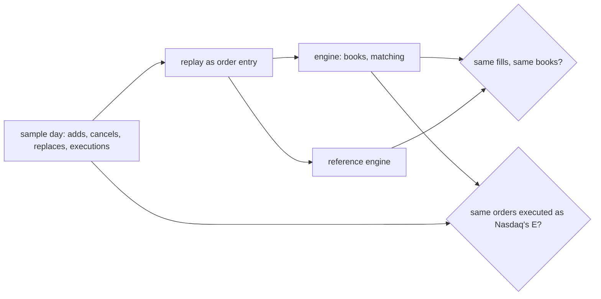

# 001 — Scope and plan

**Status:** Draft · **Updated:** 2026-11-03

## Proposal

A limit order book and matching engine: the venue's side of the trade, which the repos before
it only reconstruct (the feed handler's book applies what Nasdaq already matched) or simulate
(the gateway's venue simulator, a test fixture built on standard containers). Orders arrive, rest
or match by price-time priority, and every fill and every resting order is reported. It is
written from a public rulebook, checked against a simple reference implementation, and measured
on lockfree-ipc's harness as the others are.

It is meant to be judged on four things:

1. **Matching that is right, shown on real flow.** Price-time priority from the rulebook's text
   (D2), and the sample day's own order flow replayed as order entry, our fills compared with the
   executions Nasdaq reported for the same resting orders (D3), every disagreement classified.
2. **O(1) where it matters, with no allocation.** Add, cancel and the match of the order at the
   head of a level in constant time, from pools reserved at start; the compiled call graph
   checked, as the repos before it.
3. **Structures as measured alternatives.** The order table and the price levels each in more
   than one form, measured against each other and the reference (D4), the default chosen from
   the figures.
4. **Measured honestly.** Percentiles per operation and per message of the day, throughput over
   the day, the machine's conditions in every run; nothing typed into the README by hand.

**Where the risk is.** The costly failure is a fill the rules would not give: the wrong order at
a level matched first, a replace that keeps priority it should lose, a quantity that goes
negative or a trade through a better price. So every rule of D2 is a test built to break it, the
reference is compared after every message of the day, and the day's own executions are a second
oracle the reference cannot share our mistakes with.

It does:

- one book per instrument and an engine over them: limit and market orders, immediate-or-cancel,
  cancel (whole or part), replace (D2's priority rules);
- trades and order states reported per message, in sequence;
- a reference implementation written for clarity (ordered maps, lists): the oracle and the
  baseline;
- the sample day replayed as order entry (D3), and synthetic streams for what the day lacks;
- the benchmarks, and the report generated from committed runs, as before.

It does not:

- run auctions (Nasdaq's opening, closing and halt crosses), hidden or reserve orders, pegs,
  routing, anti-internalization or Limit Order Protection: each is a rule of its own (D2 says
  which are left out, by clause);
- take orders over a network or a protocol: the engine is a library and a benchmark (D5);
- connect to the repos before it, unless D5 says so;
- clear, settle or keep positions.

## Design

**Sources**, all public:

- *The Nasdaq Stock Market LLC Rules*, Equity 4, Rule 4757 ("Book Processing"), as amended to
  30 March 2026 (operative 29 April 2026), read from Nasdaq's rulebook on 3 November 2026: Orders
  on the book are presented to an incoming Order by price (4757(a)(1)(A)), then, among equally
  priced Orders with a Display Attribute, by time (4757(a)(1)(B)); Orders with a Non-Display
  Attribute after them, by time (4757(a)(1)(C)); an execution decrements the order by its size
  (4757(a)(2)); price improvement accrues to the taker of liquidity, so a trade is at the resting
  order's price (4757(a)(3)). The rule does not say how a modification affects priority, or what
  order types exist: those come from the rules that define them, read before D2 is agreed.
  The sample day (30 January 2020) predates amendments of November 2020 and 2022 to 2026, so
  D3's comparison is with the rule as it stood then, a cause of disagreement of its own.
- *Nasdaq TotalView-ITCH 5.0* (the feed handler's source): Add Order (A, F), Order Executed (E),
  Order Executed With Price (C), Order Cancel (X), Order Delete (D), Order Replace (U), Trade
  (P, non-displayed), Cross Trade (Q).
- The sample day of 30 January 2020, as the feed handler and tick-to-trade use it: never
  redistributed, its size and SHA-256 checked.

**What the day can and cannot check** (D3). Its adds are displayed orders that rested; its
executions say which resting order traded, how many shares and, for C, at what price; the
aggressor is never shown. So the day replays as: each add, cancel, delete and replace as order
entry; each E as an aggressive order on the other side, at the resting order's price, for the
shares executed. If our priority is Nasdaq's, the order we match is the one Nasdaq executed.
Where it is not (C at another price, crosses, non-displayed interest the feed never showed,
the rule's changes since 2020), the disagreement is counted by its cause, not hidden.

**Decisions** (each with what is proposed):

- **D1. The name.** *Proposed (A):* `matching-engine`: names what is new against the feed
  handler's book. *Alternative (B):* `limit-order-book`.
- **D2. The rules.** *Proposed (A):* Rule 4757's processing for displayed orders: price, then
  time (4757(a)(1)(A) and (B)); decrementation (4757(a)(2)); every trade at the resting order's
  price, so a match never trades through a better resting price (4757(a)(3)); a modification's
  effect on priority and the order types (limit orders, immediate-or-cancel, market orders) as the
  rules defining them say, cited when read. Left out, each named: non-displayed and reserve
  interest (4757(a)(1)(C)), Supplemental Orders and routing (4757(a)(1)(D), (b)),
  anti-internalization, the rule's self-trade prevention (4757(a)(4)), Limit Order Protection, a
  price collar at entry (4757(c)), auctions and pegs. *Alternative (B):* also reserve orders
  (displayed and non-displayed parts), the first rule that makes display matter.
- **D3. The workload and the second oracle.** *Proposed (A):* the sample day replayed as order
  entry, as above: our fills against Nasdaq's executions, agreement and every disagreement
  published by cause; plus synthetic streams (fixed seed) for what the day lacks: market orders,
  sweeps of several levels. *Alternative (B):* synthetic streams only: simpler, but
  no oracle outside our own code.
- **D4. The structures.** *Proposed (A):* measured alternatives, as the feed handler's book was:
  the order table as a direct array by ID against an open-addressing hash; price levels as a
  sorted array against a tree; each level's queue an intrusive list of orders from a pool. The
  reference (ordered maps, lists, a hash map) is the baseline. *Alternative (B):* one design,
  justified by argument.
- **D5. Threads and interfaces.** *Proposed (A):* a single-threaded engine as a library, driven
  by the benchmark and the replay; concurrency only as lockfree-ipc's SPSC ring in front of it,
  measured beside it. *Alternative (B):* also the gateway's order venue on this engine (a FIX
  acceptor matching for real): another note, after this one's are Measured.
- **D6. A third-party baseline.** *Proposed (A):* none: the reference is the baseline.
  *Alternative (B):* an open-source engine fetched by CMake at a pinned commit (Liquibook, if its
  licence and state check out before agreement).

**Notes, proposed:** 002 the rules and the book (D2, D4), 003 matching and the engine, 004 the
replay and the oracle (D3), 005 measurement and the report.

## Spec

- S1. Every rule of D2 has a test built to break it, and passes.
- S2. Over the whole sample day replayed, the engine and the reference agree after every message:
  the same fills, the same resting orders in the same order at every level.
- S3. Against the day's executions: the share of Nasdaq's E executions we reproduce (the same
  resting order, the same shares) published, and every one we do not, counted by cause; no
  unexplained cause left without an open item.
- S4. Add, cancel and the match at a level's head make no allocation and no system call in steady
  state (the compiled call graph checked).
- S5. Per-operation latency (add, cancel, replace, matches of one and several levels) and the
  day's per-message latency and throughput published as percentiles over at least three runs,
  beside the reference (and D6's baseline if chosen), via `run.py report`.
- S6. Each alternative of D4 published beside the others; the default justified from them.

## Tasks

- [ ] Shep: empty GitHub repo (private), named per D1
- [ ] Notes 002–005, one at a time, each agreed before its code

## Review

| Date | Stage | Finding |
|---|---|---|
| 2026-11-03 | Draft | Written from Shep's ideas (a pasted outline) and the record. From the outline: price-time priority, O(1) cancel by ID, intrusive lists, pools, per-operation workloads, percentiles. Not taken, against the established standard: means (percentiles only), `-march=native` (the build's flags are fixed and recorded), subtracting the timer's overhead (stated beside the figures instead), typed-in README numbers and CSV output (JSON runs and a generated report), its hardware line (wrong: 2 × 22 cores, 88 threads). Rule 4757 found in SEC filings; its live text to be read before agreement. Liquibook's licence and maintenance not confirmed |
| 2026-11-03 | Draft | D1 agreed by Shep: `matching-engine` (the exchange's side, the book that decides the fills; the feed handler's book is a copy that applies them) |
| 2026-11-03 | Draft | Rule 4757's live text read (Shep's paste from Nasdaq's rulebook; its site refuses automated fetches): D2 checked clause by clause and cited. Changed: Extended Life Priority is not in the current text (removed); Limit Order Protection (4757(c)) added to what is left out; anti-internalization named as the rule's self-trade prevention. Not in 4757: how a modification affects priority, and the order types (fill-or-kill dropped until a rule offers it): both from the rules defining them, before D2 is agreed. The rule was amended after the sample day (Nov 2020, 2022-2026): a cause of disagreement in D3 |
