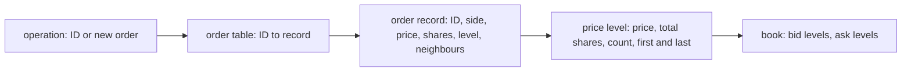

# 002 — The rules and the book

**Status:** Measured · **Updated:** 2026-11-04

## Proposal

Note 001's D2 and D4 for one instrument's book, before any matching (note 003): orders enter,
rest at the back of their price level, are cancelled in part or in whole, or replaced, and the
book always shows the levels and each level's queue in time priority. Entry is checked against
Rule 4703's sizes and price. Each operation is answered, and a refusal says why.

It does:

- the order record, the pool it comes from, each level's queue (an intrusive list through the
  records), the levels per side, the order table from ID to record;
- the operations: add (rest), cancel part, cancel whole, replace, each answered (done, or refused
  with a reason);
- D4's structures in two forms each, and a reference book written for clarity, the oracle and the
  baseline;
- tests of each rule built to break it, a random-stream comparison with the reference, and the
  per-operation measurement.

It does not:

- match: an incoming order that would cross is note 003's; the book rests what it is given, so
  keeping it uncrossed is the engine's (D5);
- replay the sample day as order entry (note 004): this note's day figures apply its book events
  directly (D7).

## Design

**The rules this note implements** (note 001, D2):

| Rule | Source | In the book |
|---|---|---|
| Better price first | 4757(a)(1)(A) | levels per side, best first |
| Equal price, displayed: time | 4757(a)(1)(B) | each level's queue, new orders at the back |
| Cancel at any time | 4703(a) | cancel whole: the record leaves its queue and the pool |
| Cancel part keeps the place | ITCH 5.0, Order Cancel | shares reduced, position unchanged; at zero, removed |
| Replace is a new order at the back | ITCH 5.0, Order Replace | the old record removed; a new ID, at the back of its (new) level |
| Sizes 1 to 999,999 whole shares | 4703(b) | refused outside |
| Every order priced, at most $199,999.99 | 4703(c) | refused if zero, negative or above |

Prices are integers with four implied decimals, as in ITCH 5.0 (the maximum, 1,999,999,900, fits
32 bits); shares 32-bit. IDs are the engine's: assigned in sequence from 1, so dense by
construction, unlike the feed handler's reference numbers (45% of their range used, its note 002).

**Decisions** (each with what is proposed):

- **D1. The order table.** Two forms, measured (note 001, D4):
  - *A.* a direct array indexed by ID: the IDs are dense, so no hashing and no probe; its size
    grows with every order ever entered (the sample day's 223 million adds and replaces: 0.9 GB of
    32-bit record indexes), faulted in as it grows, so S3's check runs with it pre-faulted to a
    configured capacity and refuses past it;
  - *B.* open addressing over a fixed table sized for the orders live at once, allocated and
    pre-faulted at start: memory bounded by live orders, a hash and a probe an operation.
    Linear probing in Robin Hood order (amended, Review 2026-11-03), so a deletion's backward
    shift stops at the first entry in its home slot.
  - *C*, the ID's low bits as the home slot (`id & mask`), was added by Shep's decision, built,
    and dropped (Shep A, Review 2026-11-03): the day's long-resting orders make runs thousands
    long once the IDs wrap the table.
  *Proposed:* both built and measured; the default chosen from the figures.
- **D2. The price levels.** Two forms, measured:
  - *A.* a sorted array per side, best at the end, as the feed handler's default (most changes
    are near the best, so inserts and removals move few entries);
  - *B.* a tree: `std::map` over a pool allocator reserved at start, so it allocates nothing after
    start (the reference's container, without its allocations).
  *Proposed:* both built and measured; the default chosen from the figures.
- **D3. The queue and the records.** *Proposed:* every order record from one pool reserved and
  pre-faulted at start; each level's queue an intrusive doubly linked list through the records,
  so removing any order is constant time once found. *Alternative:* a ring of IDs per level:
  cache-friendlier at the head, but a cancel in the middle costs a search or a tombstone.
- **D4. Capacity.** *Proposed:* orders live at once, levels per side and (for D1 A) IDs, sized
  at start from configuration and pre-faulted; running out refuses the operation, counted, never
  a crash. Defaults from the sample day: 1,925,638 orders live at its peak (the feed handler's
  note 002), so 4 million; levels from the busiest book (5,482), so 16,384 a side.
- **D5. Locked and crossed.** *Proposed:* the book does not check: it rests what it is given, and
  the engine (note 003) matches an incoming order before anything of it rests, so the engine's
  book is never locked or crossed. The day's own book was crossed during halts (4,821 events, the
  feed handler's note 002, D6), so D7 applies its events to a book that must allow it.
  *Alternative:* the book refuses a locking or crossing add: a second check of what the engine
  guarantees, and it would refuse the day's events in halts.
- **D6. Refusals.** *Proposed:* every refusal answered with its reason and counted: size or price
  out of range (4703(b), (c)), unknown or finished ID, cancel of more shares than remain,
  capacity. Nothing changes in the book on a refusal.
- **D7. Workloads.** *Proposed:* synthetic streams (fixed seed) for the random comparison and the
  per-operation figures (add to a level near the best and far from it, cancel at a level's head,
  middle and tail, cancel part, replace within and across levels); and the sample day's displayed
  book events (Add, Cancel, Delete, Replace, and executions applied as reductions of the named
  order) read through the feed handler's decoder, fetched at a pinned commit, as tick-to-trade
  does: the same day as the feed handler's book, so the two books' figures can stand side by side.
  *Alternative:* synthetic only.

**Alternatives recorded for later** (not built by this note; each would be measured against
the agreed design, as D1 and D2 are). The agreed design is correct for the operations but not
built around memory traffic, and on this machine memory is the cost: an operation follows
dependent reads (order table, record, level), mostly cache and TLB misses with millions of
orders live (the feed handler's note 002: the lookup, not the levels, is what every event pays).

- *Huge pages* for the pools and the order table: 4 million records of 64 bytes are 256 MB, and
  with 4 KB pages nearly every random read is a TLB miss too (the feed handler's hold gained from
  them, its note 005).
- *A hot record of 32 bytes*: matching needs price, shares and the queue's two links; ID, owner
  and entry time kept apart; 32-bit indexes in place of pointers: two orders a cache line.
- *A contiguous queue per level* (D3's alternative), measured rather than argued: a sweep reads
  from the head, which a contiguous queue prefetches and a list chases; cancels from the middle
  leave tombstones, removed later. The day's flow (mostly adds and cancels) favours the list,
  sweeps the queue.
- *A level array indexed by price with a bitmap of occupied prices* (a third form of D2): a level
  found in one step; the next best after a sweep empties one by a find-first-set. The feed
  handler's like structure was its fastest book, by about 6% in throughput for about 10% more
  memory.
- *Prefetching the next operation's record* while the current one is done: throughput, not one
  operation's latency, and it needs input batched ahead.
- *A blocked hash for D1 B*: groups of 4 consecutive IDs hashed as one, so a group shares a
  cache line and the groups scatter (Review 2026-11-03: table C's locality without its runs).

## Spec

- S1. Each rule in the table above has a test built to break it, and passes; each refusal of D6
  has a test, and the book is unchanged after it.
- S2. Random streams of operations (fixed seeds, at least 10 million operations over books of
  thousands of levels): the fast books in every combination of D1 and D2 and the reference agree
  after every operation (the same answers, the order, every level touched in full; every book in
  full every 100,000 operations and at the end: amended in building, Review).
- S3. Add, cancel and replace make no allocation and no system call (the compiled call graph
  checked, as the repos before it).
- S4. The sample day's displayed book events applied to each book: after every event the same
  answers and every level touched equal to the reference; every 50 million messages and at the
  end every book in full equal to the reference, and the reference to the feed handler's
  reference book (amended at review: by the close every book is empty, Review).
- S5. Per-operation latency (D7's synthetic cases) and the day's per-event latency and throughput,
  each combination of D1 and D2 and the reference, as percentiles over at least three runs via
  `run.py report`; memory stated.
- S6. The default of D1 and D2 justified from S5's figures.

## Tasks

- [x] Order record, pool, intrusive queue; the levels (D2 A, B); the order table (D1 A, B)
- [x] The book: add, cancel part and whole, replace, refusals (D6)
- [x] The reference book
- [x] Tests: the rules (S1), random streams (S2), the call graph (S3), the day (S4)
- [x] Benchmarks and `run.py` (S5)
- [x] Shep's runs; review

## Review

| Date | Stage | Finding |
|---|---|---|
| 2026-11-03 | Draft | Written from note 001 (D2, D4) and the feed handler's note 002 (its structures and the sample day's peaks). Found: the engine assigns its own IDs in sequence, so a direct array by ID is dense by construction (the feed handler's had 45% of its range used); its cost is memory growing with every order entered, against open addressing's bound on live orders (D1). A first version of D5 refused locking or crossing adds; dropped before review: the day's book was crossed in halts, and keeping the book uncrossed is the engine's (note 003) |
| 2026-11-03 | Agreed | Shep asked whether the standard design could be improved: five alternatives recorded above for later (huge pages, a 32-byte hot record, a contiguous queue, a price-indexed level array with a bitmap, prefetching), not built here. Approved by Shep, every decision as proposed (option A each): D1 and D2 each in two forms, measured; D3 one pool and an intrusive queue; D4 capacity from configuration; D5 the book does not check crossing; D6 refusals answered and counted; D7 synthetic streams and the day's book events |
| 2026-11-03 | Agreed (building) | Built: `market.hpp` (the books over shared pools: one record pool, one level pool, one order table; a replace reuses its record, unlinked and relinked, so it needs no second record and a refusal changes nothing), `levels.hpp` (A: sorted arrays in one arena shared by every book, chunks doubling 8 to 16,384, as the feed handler's; B: `std::map` over a fixed node pool), `order_table.hpp` (A: direct array; B: open addressing, linear probing, backward-shift deletion), `reference_market.hpp`. Tests: `book_test` (S1, 147 checks over the four combinations and the reference), `random_test` (S2: 10 million operations over two seeds, sides to ~3,200 levels; after every operation the answer, the order and every level touched in full, every book in full each 100,000; a planted bug, a partial cancel not reducing its level, caught at operation 7), `check_hot_path` (S3: 16 subjects; D2 B on `std::allocator` caught), `day_test` (S4). Clean under ASan and UBSan. Found: (1) S2's first runs failed at 1,048,577 live orders, one past the test's configured capacity: the fast books refused as they should and the reference, without capacity, did not; the stream now holds live orders near 100,000. (2) The node pool's unreachable exhaustion was a throw, and a throw allocates (S3 flagged it): now a trap. (3) S4's end-of-day comparison compared nothing: every order is gone by the close. Full books are now compared every 50 million messages too (at 100 million: 1,743,843 orders live, 26,697 books, all equal to the reference and to the feed handler's reference book); the day's peak, 1,925,638 orders live, is the feed handler's figure exactly. (4) Trial of `book_bench` (not bench mode): the day is 417,219,234 operations of 423,285,709 messages, none left out; levels A with table A 11.2 M operations a second, p50 107 ns, 1,321 MB; table B (open addressing) is slower even in the synthetic book that stays in cache (an add at the best level p50 137 against 37 ns): sequential IDs through a multiplicative hash land at random in a 128 MB table, a cache and TLB miss each, where the direct array keeps consecutive IDs together. An alternative not agreed: open addressing indexed by the ID's low bits (`id & mask`), bounded memory with the direct array's locality: for Shep. The reference's maximum, 145 ms, is its containers growing |
| 2026-11-03 | Agreed (building) | Decided by Shep (A): table C built (open addressing, the ID's low bits as the home slot), measured beside A and B. S1 (207 checks over six combinations and the reference), S2 (10 million operations, all six equal to the reference) and S3 (24 subjects) pass with it. S2 as built compares, after every operation, the answer, the order and every level touched, and every book in full each 100,000 (comparing every book after every operation is O(levels) an operation): the Spec amended to say so. Shep asked whether the records come from a pool: they do, all of them (order records, levels, D2 A's arena, D2 B's nodes, the order table), each allocated once at start; the queue's links are fields of the order records, so the list has no nodes of its own; S3 checks nothing else allocates |
| 2026-11-03 | Agreed (building) | Shep's bench-mode check run (not published): five books within 4% of the trial; table C 0.50 M operations a second (levels A; 0.47 with B), its cancels p99 57 us; synthetic cancel at a level's head 13.3 us, middle 6.7, tail 1.4. Cause: with the ID's low bits as home, consecutive IDs fill consecutive slots, every live order one run without gaps, and the backward-shift deletion scanned to the run's end (an empty slot); erasing the oldest of 10,000 sequential IDs 15 us against B's 241 ns. The tests check results, not cost; C was chosen on B's add and its cancel never timed before the check run. Decided by Shep (A): Robin Hood order in the open-addressing table for B and C both (one algorithm, only the home differs), so a deletion stops at the first entry in its home slot and a missed lookup at the first entry nearer its home than the probe; D1 amended. After: the same erase 72 ns in C, 291 in B. Tests, sanitizers and the whole day rerun; a new check run follows |
| 2026-11-03 | Agreed (building) | Trial after the Robin Hood change (not bench mode): C's synthetic cancels 23-25 ns (A 21), but the day unchanged, 0.50 M operations a second, add p99 36 us, cancel p99 39 us. A simulation of the table over the day's IDs (first 150 million messages) found the cause: about 1.7 million orders live, many resting for hours; the IDs wrap the 2^23-slot table every 8 million, and with low-bit homes the newest IDs sweep in order through slots still held by old orders, each one passed pushing every later insert one further: longest run ~9,000, put probes p99 16k-32k, erase scan p99.9 32k-65k (B: under 8, longest run 10-11). A 2^25 table only delays it to its first wrap (8,787). Any home that keeps consecutive IDs together sweeps the old orders so; the 10,000-ID probe never wrapped the table. Decided by Shep (A): C dropped from the code, tests and benchmark; A and B measured as first agreed, Robin Hood order kept in B; a blocked hash recorded for later |
| 2026-11-04 | Measured | Shep's check run at 7976374 clean (A/A 10.90 M operations a second); three runs published (c3f0f45; 20261103T211459Z, 213625Z, 215750Z). Against the Spec: S1, S2 (as amended), S3 met; S4 met as amended (Shep A: the end-of-day comparison was empty, so its wording now says what was built: answers and touched levels after every event, every book in full every 50 million messages and at the end, up to 1,871,048 orders live); S5 met. S6 (Shep A): the default is levels A with table A, `me::book`: on the day 10.89-10.94 M operations a second against 6.10-6.13 for either half alone and 4.20-4.23 for B with B, p50 112 against 136 (levels B) and 189 (table B), p99.9 627-628 against 887-916, every operation type fastest; the cost is memory, 1,321 MB against 425. Levels B wins one synthetic case, an add at a new level far from the best (80-82 against 181 ns: the sorted array's shift), which the day does not show. Open item M1 (Shep A): table A's ID capacity, a limit stated in RESULTS. A/B's maximum 40.6 us in one run of three (others 18.1-21.1 us): no item, changes no conclusion. Runs took 21.5 minutes each (the timed and untimed passes of each book, the conversion); quoted as 9 to Shep |
